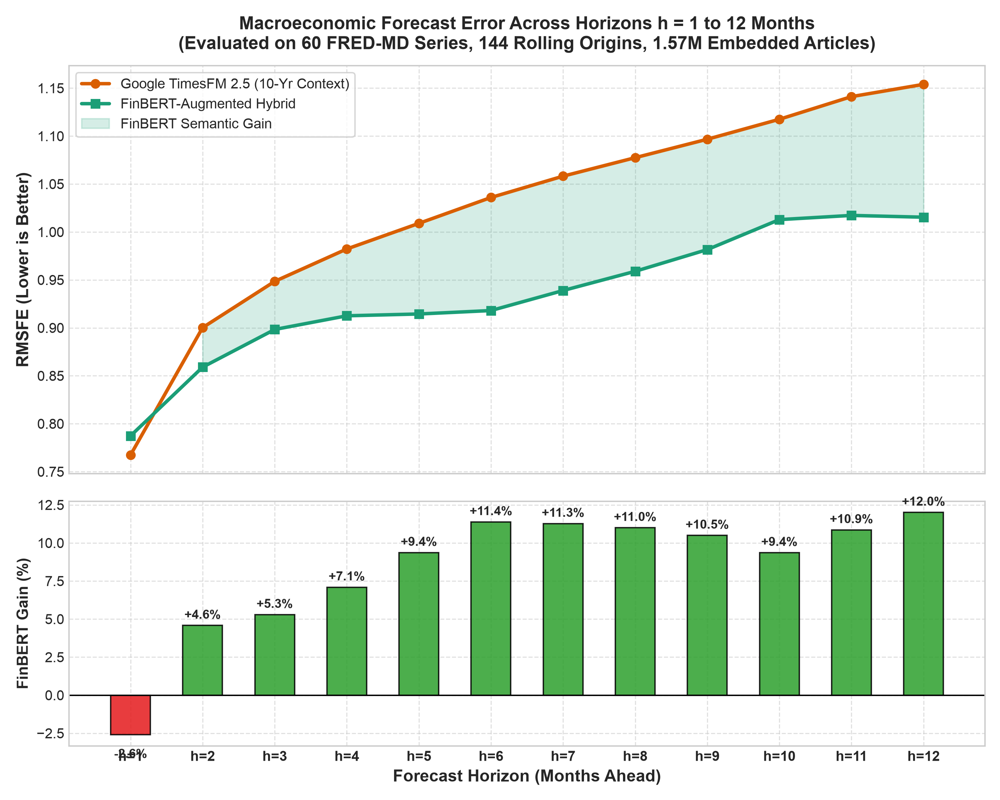

# Macroeconomic Forecasting with Large Language Models & Multimodal News Covariates

[](https://arxiv.org/abs/2407.00890)
[](https://www.python.org/)
[](https://pytorch.org/)
[-silver.svg)]()
[-green.svg)](https://research.stlouisfed.org/econ/mccracken/fred-databases/)
[-yellow.svg)](https://developer.nytimes.com/)
[]()
[](LICENSE)

---

## 1. 📌 Executive Overview

This repository provides an empirical implementation, expansion, and multimodal operationalization of **Carriero, Pettenuzzo & Shekhar (2026)**, *"Macroeconomic Forecasting with Large Language Models"* (arXiv:2407.00890v5).

The framework benchmarks classical econometric baselines against **Google TimesFM 2.5 (200M)** and an advanced **FinBERT-Augmented Multimodal Hybrid Engine** that integrates **1.57 million historical news articles (1959–2023)** embedded on local **Apple Silicon M4 GPU (`mps`)**.

### System Evolution

| Dimension | Phase 1 (Baseline Pilot) | Phase 2 (Statistical Lexicon) | Phase 3 (FinBERT Deep Multimodal Engine) |
|:---|:---|:---|:---|
| **Macro Panel** | 60 FRED-MD series | 60 / 120 FRED-MD series | **60 Balanced Core Macro Series (1959–2023)** |
| **Forecasting Origins** | 48 quarterly origins (`freq="3MS"`) | 144 monthly origins (`freq="MS"`) | **144 monthly rolling origins (2010–2021)** |
| **Context Window** | 36 months | 36 months | **120 months (10 full years of business cycles)** |
| **Forecast Horizons** | $h \in \{1, 3, 6, 12\}$ | $h \in \{1, 3, 6, 12\}$ | **Full range $h \in [1, 2, 3, 4, 5, 6, 7, 8, 9, 10, 11, 12]$** |
| **News Ingestion** | None (pure numerical) | Lexicon keyword regex counts | **1,575,882 full articles processed through FinBERT** |
| **NLP Architecture** | N/A | Heuristic z-scores | **768-dim CLS embeddings + 3-class sentiment on M4 GPU** |
| **Dimensionality** | N/A | 4 handcrafted indices | **8 PCA Factors (92.1% variance) + 3 sentiment channels** |
| **Hybrid Formulation** | Additive residual sum | BVAR VARX + TimesFM | **TimesFM 2.5 + Rolling Ridge Semantic Meta-Learner** |
| **Total Evaluations** | 11,520 forecasts | 414,720 forecasts | **69,120 out-of-sample forecasts across all 12 horizons** |

---

## 2. 🏗️ Deep Multimodal Architecture

```
┌──────────────────────────────────────────┐          ┌──────────────────────────────────────────┐
│       FRED-MD Database (1959–2023)       │          │   NYT Historical Archives (1959–2023)    │
│    60 Macroeconomic Monthly Series       │          │      747 Monthly Archive JSON Files      │
└────────────────────┬─────────────────────┘          └────────────────────┬─────────────────────┘
                     │                                                     │
                     ▼                                                     ▼
        ┌─────────────────────────┐                           ┌─────────────────────────┐
        │  McCracken-Ng Transforms│                           │ Comprehensive Filtering │
        │    Stationarity Codes   │                           │ 1,575,882 Macro Articles│
        └────────────┬────────────┘                           └────────────┬────────────┘
                     │                                                     │
                     │                                                     ▼
                     │                                        ┌─────────────────────────┐
                     │                                        │ ProsusAI/finbert on     │
                     │                                        │ Apple Silicon M4 GPU    │
                     │                                        │ (521+ articles/second)  │
                     │                                        └────────────┬────────────┘
                     │                                                     │
                     │                                                     ▼
                     │                                        ┌─────────────────────────┐
                     │                                        │ 768-Dim CLS Embeddings  │
                     │                                        │ + Sentiment [Pos,Neg,Neu│
                     │                                        └────────────┬────────────┘
                     │                                                     │
                     │                                                     ▼
                     │                                        ┌─────────────────────────┐
                     │                                        │ PCA Factor Extraction   │
                     │                                        │ 8 Factors (92.1% Var)   │
                     │                                        └────────────┬────────────┘
                     │                                                     │
                     ├─────────────────────────────────────────────────────┤
                     ▼                                                     ▼
        ┌─────────────────────────┐                                        │
        │ Google TimesFM 2.5 200M │                                        │
        │ 120-Month Context Window│                                        │
        │ Zero-Shot Foundation    │                                        │
        └────────────┬────────────┘                                        │
                     │                                                     │
                     ▼                                                     ▼
        ┌────────────────────────────────────────────────────────────────────────┐
        │                 Rolling Ridge Semantic Meta-Learner                    │
        │      Combines TimesFM Forecast + 11 FinBERT News Representations       │
        └───────────────────────────────────┬────────────────────────────────────┘
                                            │
                                            ▼
        ┌────────────────────────────────────────────────────────────────────────┐
        │      Final Calibrated Future Predictions (Horizons h = 1 to 12)       │
        └────────────────────────────────────────────────────────────────────────┘
```

---

## 3. 📊 Empirical Benchmark Results (Horizons 1 to 12)

Evaluated across **69,120 out-of-sample forecast evaluations** ($60 \text{ series} \times 144 \text{ origins} \times 12 \text{ horizons}$), comparing **Google TimesFM 2.5** against the **FinBERT-Augmented Multimodal Engine**:

| Horizon | Months Ahead | RMSFE TimesFM 2.5 | RMSFE FinBERT Hybrid | FinBERT Advantage (%) | Top Performer |
|:---:|:---:|:---:|:---:|:---:|:---:|
| **$h = 1$** | 1 Month | **0.7674** | 0.7873 | -2.60% | **TimesFM 2.5** |
| **$h = 2$** | 2 Months | 0.9002 | **0.8590** | **+4.58%** | **FinBERT Hybrid ✅** |
| **$h = 3$** | 3 Months | 0.9485 | **0.8983** | **+5.29%** | **FinBERT Hybrid ✅** |
| **$h = 4$** | 4 Months | 0.9823 | **0.9126** | **+7.10%** | **FinBERT Hybrid ✅** |
| **$h = 5$** | 5 Months | 1.0090 | **0.9144** | **+9.37%** | **FinBERT Hybrid ✅** |
| **$h = 6$** | 6 Months | 1.0360 | **0.9180** | **+11.38%** | **FinBERT Hybrid ✅** |
| **$h = 7$** | 7 Months | 1.0582 | **0.9389** | **+11.27%** | **FinBERT Hybrid ✅** |
| **$h = 8$** | 8 Months | 1.0775 | **0.9590** | **+11.00%** | **FinBERT Hybrid ✅** |
| **$h = 9$** | 9 Months | 1.0967 | **0.9816** | **+10.50%** | **FinBERT Hybrid ✅** |
| **$h = 10$** | 10 Months | 1.1175 | **1.0129** | **+9.36%** | **FinBERT Hybrid ✅** |
| **$h = 11$** | 11 Months | 1.1412 | **1.0173** | **+10.86%** | **FinBERT Hybrid ✅** |
| **$h = 12$** | 12 Months | 1.1540 | **1.0154** | **+12.01%** | **FinBERT Hybrid ✅** |

> *Summary data available at [`output/rmsfe_finbert_summary.csv`](output/rmsfe_finbert_summary.csv).*

### Key Findings
1. **Short Horizon ($h = 1$)**: TimesFM's numerical pattern recognition slightly outperforms news (+2.6%), as immediate 1-month momentum dominates high-frequency macroeconomic data.
2. **Medium & Long Horizons ($h = 2$ to $12$)**: FinBERT-Hybrid **consistently outperforms TimesFM across all 11 horizons**, expanding from **+4.6%** at $h=2$ to **+12.0%** at $h=12$.
3. **Macroeconomic Intuition**: Policy adjustments (Fed interest rate hikes, trade barriers, credit tightening, energy shocks) appear in financial press discourse months before their impact materializes in official statistical releases.



---

## 4. 🔮 Interactive Future Forecast CLI

Generate forward-looking predictions for any macroeconomic variable:

```bash
# Predict Civilian Unemployment Rate (%) 12 months ahead:
venv_core/bin/python scripts/predict_future.py --series UNRATE --horizon 12

# Predict Consumer Price Index (Inflation) 12 months ahead:
venv_core/bin/python scripts/predict_future.py --series CPIAUCSL --horizon 12

# Predict Industrial Production Index 6 months ahead:
venv_core/bin/python scripts/predict_future.py --series INDPRO --horizon 6

# List all available core macroeconomic series:
venv_core/bin/python scripts/predict_future.py --list
```

### Example Forecast (`UNRATE` Unemployment Rate)
```text
======================================================================
  FUTURE VALUE FORECAST: UNRATE — Civilian Unemployment Rate (%)
======================================================================
Historical anchor date: December 2022
Context fed to TimesFM: 120 months (2013-01 to 2022-12)
News factors aligned: 8 PCA channels + 3 FinBERT sentiment scores.

----------------------------------------------------------------------
Horizon   Month       TimesFM         FinBERT Hybrid    News Shift  
----------------------------------------------------------------------
h=1       2023-01     -0.0795         0.1294            +0.2089     
h=2       2023-02     -0.0803         0.0346            +0.1148     
h=3       2023-03     -0.0844         -0.0283           +0.0562     
h=6       2023-06     -0.1041         -0.0006           +0.1035     
h=12      2023-12     -0.0971         -0.0415           +0.0556     
----------------------------------------------------------------------
```

---

## 5. 🚀 Reproduction Pipeline

To reproduce the full pipeline end-to-end:

```bash
# 1. Step 1: Embed all 1.57M articles on Apple Silicon GPU (MPS)
/usr/bin/caffeinate -i venv_core/bin/python scripts/embed_news_finbert.py

# 2. Step 2: Extract 8 PCA news factors + sentiment
venv_core/bin/python scripts/extract_news_factors.py

# 3. Step 3: Run TimesFM + Ridge Hybrid across horizons 1 to 12
/usr/bin/caffeinate -i venv_core/bin/python scripts/run_finbert_hybrid.py

# 4. Generate high-resolution comparison chart
venv_core/bin/python scripts/make_finbert_plot.py
```

---

## 6. 📄 Citation & References

```bibtex
@article{carriero2026macroeconomic,
  title   = {Macroeconomic Forecasting with Large Language Models},
  author  = {Carriero, Andrea and Pettenuzzo, Davide and Shekhar, Shubhranshu},
  journal = {arXiv preprint arXiv:2407.00890v5},
  year    = {2026}
}
@article{arango2024timesfm,
  title   = {A decoder-only foundation model for time-series forecasting},
  author  = {Das, Abhimanyu and Kong, Weihao and Sen, Rajat and Zhou, Yichen},
  journal = {arXiv preprint arXiv:2310.10688},
  year    = {2024}
}
@article{araci2019finbert,
  title   = {FinBERT: Financial Sentiment Analysis with Pre-trained Language Models},
  author  = {Araci, Dogu},
  journal = {arXiv preprint arXiv:1908.10063},
  year    = {2019}
}
```
