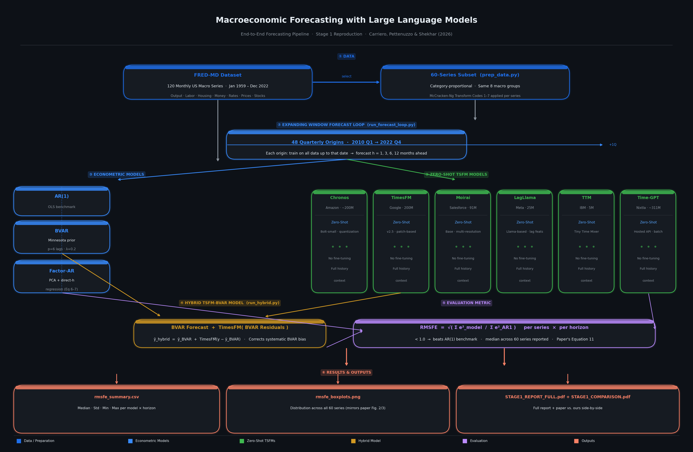
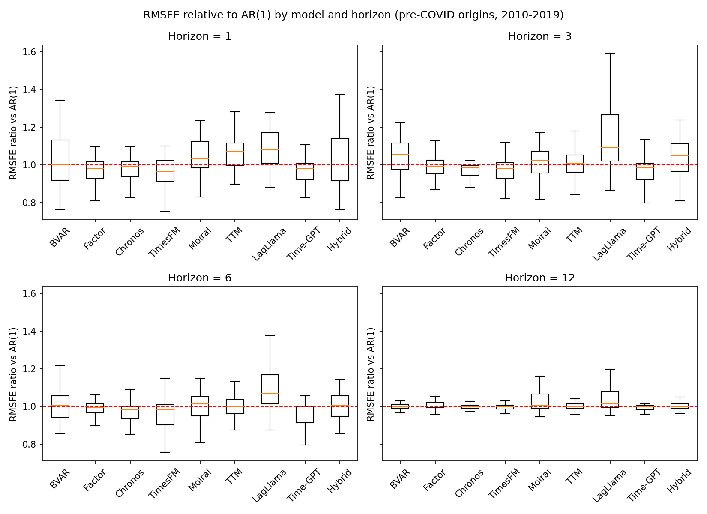

# Macroeconomic Forecasting with Large Language Models

[](https://arxiv.org/abs/2407.00890)
[](https://www.python.org/)
[](https://pytorch.org/)
[](https://research.stlouisfed.org/econ/mccracken/fred-databases/)
[]()
[](LICENSE)

---

## 1. 📌 Project Overview

An empirical implementation and comparative evaluation of **Carriero, Pettenuzzo & Shekhar (2026)**, *"Macroeconomic Forecasting with Large Language Models"* (arXiv:2407.00890v5). The project benchmarks classical econometric models against state-of-the-art **Zero-Shot Time-Series Foundation Models (TSFMs)** and a **Hybrid Residual-Correction Architecture** on monthly US macroeconomic data from FRED-MD.

**Core scope:**
- **60** balanced monthly US macro series, Jan 1959 – Dec 2022, across all 8 FRED-MD economic groups
- **48** quarterly expanding-window forecast origins (2010 Q1 – 2022 Q4), horizons h ∈ {1, 3, 6, 12} months
- **3** econometric benchmarks + **6** zero-shot TSFMs + **1** hybrid model evaluated end-to-end

---

## 2. 🚀 Application

This project delivers a fully reproducible forecasting pipeline with:

| Component | Description |
|:---|:---|
| **Data pipeline** | Automated FRED-MD ingestion, 60-series selection, McCracken-Ng stationarity transforms |
| **Econometric engine** | AR(1), Minnesota-Prior BVAR (p=6, λ=0.2), Factor-AR (Stock-Watson PCA) |
| **TSFM inference** | Zero-shot forecasting via 6 foundation models — no re-training, pretrained weights only |
| **Hybrid model** | BVAR base forecast + TimesFM residual correction |
| **Evaluation** | Relative RMSFE vs. AR(1) benchmark, distributed across 60 series, 48 origins |
| **Reporting** | Automated PDF report, CSV summary, boxplot visuals |

All scripts are runnable end-to-end from `/Users/nilesh/LLM` with no manual intervention.

---

## 3. 🎯 Problem Statement

> **Can pretrained Time-Series Foundation Models (TSFMs) — the "LLMs of forecasting" — beat traditional econometric methods at forecasting macroeconomic aggregates in a zero-shot manner?**

Forecasting macroeconomic time series has historically been dominated by:
- **AR(1)** — parsimonious univariate autoregressions
- **BVAR** — Bayesian Vector Autoregressions with Minnesota shrinkage priors
- **Factor models** — PCA-based diffusion index autoregressions (Stock & Watson)

Recent large pretrained models trained on vast corpora of diverse time series claim competitive zero-shot forecasting accuracy without any task-specific fine-tuning. This project empirically tests that claim on a rigorous, real macroeconomic benchmark using the exact methodology of Carriero et al. (2026).

**Evaluation metric — Relative RMSFE (Eq. 11 of the paper):**

$$\text{RMSFE}_{\text{rel}} = \sqrt{\frac{\sum_{t} (y_{t+h} - \hat{y}_{t+h}^{\text{model}})^2}{\sum_{t} (y_{t+h} - \hat{y}_{t+h}^{\text{AR(1)}})^2}}$$

Values **< 1.000** mean the model beats the AR(1) benchmark. Values > 1.000 mean it performs worse.

---

## 4. 📂 Dataset

The project uses the **FRED-MD** monthly macroeconomic database ([McCracken & Ng, 2016](https://doi.org/10.1080/07350015.2015.1086655)) — the same dataset as the original paper.

### Series Selection (60 of 120)

We select 60 balanced series preserving proportional representation across all 8 macroeconomic groups:

| Group | Category | Count | Representative Series |
|:---:|:---|:---:|:---|
| 1 | **Output and Income** | 8 | `RPI`, `INDPRO`, `IPFPNSS`, `IPMANSICS`, `IPB51222S` |
| 2 | **Labor Market** | 16 | `PAYEMS`, `UNRATE`, `UEMPMEAN`, `CLAIMSx`, `HWI` |
| 3 | **Housing** | 5 | `HOUST`, `HOUSTNE`, `HOUSTMW`, `HOUSTS`, `PERMIT` |
| 4 | **Consumption & Orders** | 5 | `DPCERA3M086SBEA`, `AMDMNOx`, `ANDENOx` |
| 5 | **Money and Credit** | 6 | `M1SL`, `M2SL`, `BUSLOANS`, `REALLN`, `NONREVSL` |
| 6 | **Interest & Exchange** | 11 | `FEDFUNDS`, `TB3MS`, `GS10`, `T10YFFM`, `EXUSUKx` |
| 7 | **Prices & Inflation** | 7 | `CPIAUCSL`, `PCEPI`, `WPSFD49207`, `OILPRICEx` |
| 8 | **Stock Market** | 2 | `S&P 500`, `S&P: indust` |

### McCracken-Ng Stationarity Transformations

Each raw series $x_t$ is transformed to near-stationary $y_t$ using its assigned code:

| Code | Transformation | Formula |
|:---:|:---|:---|
| 1 | No transformation | $y_t = x_t$ |
| 2 | First difference | $y_t = x_t - x_{t-1}$ |
| 3 | Second difference | $y_t = \Delta^2 x_t$ |
| 4 | Log level | $y_t = \ln(x_t)$ |
| 5 | Log difference (growth rate) | $y_t = \ln(x_t) - \ln(x_{t-1})$ |
| 6 | Second log difference | $y_t = \Delta^2 \ln(x_t)$ |
| 7 | Pct-change difference | $y_t = \Delta(x_t / x_{t-1})$ |

*Output:* `data/fredmd_clean.parquet` — 768 months × 60 transformed series.

---

## 5. ⚖️ Our Approach vs. the Original Paper

The project follows the paper's logic — same dataset, same relative-RMSFE metric, same benchmark family, same BVAR-plus-TSFM hybrid — but differs in scale and several design choices to make it tractable on CPU hardware.

| Aspect | Original paper (Carriero et al.) | This work |
|:---|:---|:---|
| **Data** | FRED-MD, 120 monthly series, 1959–2022 | FRED-MD, 60 balanced series, 1959–2022 |
| **Evaluation** | Jan 1985 – Dec 2019 (main); monthly origins; h = 1, …, 12 | 2010 Q1 – 2022 Q4; 48 quarterly origins; h = 1, 3, 6, 12 |
| **Benchmarks** | AR(1), BVAR, Factor model, NNAR, BART | AR(1), BVAR, Factor-AR |
| **BVAR prior** | Minnesota + sum-of-coefficients + single-unit-root; p = 6; λ by marginal likelihood | Minnesota prior; p = 6; λ = 0.2 fixed |
| **TSFMs** | MOIRAI (base, large), TimesFM, TTM, TimeGPT, Lag-Llama | TimesFM 2.0/2.5, TimeGPT, Chronos-Bolt, MOIRAI, TTM, Lag-Llama |
| **Hybrid** | BVAR + MOIRAI-large and BVAR + TimesFM | BVAR + TimesFM |
| **Extra analyses** | Diebold-Mariano tests, COVID split, data-leakage test, persistence split, fine-tuning | Not yet implemented |

We additionally evaluate **Chronos-Bolt** (Amazon's faster successor to Chronos-T5) and the newer **TimesFM 2.0/2.5**, which were not available at the time of the original paper.

---

## 6. 🏗️ Architecture & Pipeline

```
  ┌─────────────────┐       select 60 series       ┌──────────────────────┐
  │  FRED-MD Data   │ ───────────────────────────► │  Clean Dataset (60)  │
  │  (120 series)   │   McCracken-Ng Transforms    │  (1959-01 – 2022-12) │
  └─────────────────┘                              └──────────┬───────────┘
                                                             │
                                                             ▼
                                            ┌─────────────────────────────────┐
                                            │ Expanding-Window Engine         │
                                            │ 48 Quarterly Origins (2010–2022)│
                                            │ Horizons h ∈ {1, 3, 6, 12}     │
                                            └────────┬───────────────┬────────┘
                                                     │               │
                           ┌─────────────────────────┘               └────────────────────────┐
                           ▼                                                                  ▼
       ┌───────────────────────────────────────┐                  ┌────────────────────────────────────────┐
       │        Econometric Benchmarks         │                  │         Zero-Shot TSFM Models          │
       │  • AR(1) Direct OLS (reference)       │                  │  • Google TimesFM 2.0 / 2.5            │
       │  • BVAR (Minnesota Prior, p=6)        │                  │  • Amazon Chronos-Bolt                 │
       │  • Factor-AR (Stock-Watson PCA)       │                  │  • Salesforce MOIRAI                   │
       └───────────────────┬───────────────────┘                  │  • Meta Lag-Llama                      │
                           │                                      │  • IBM Tiny Time Mixer (TTM)           │
                           │                                      │  • Nixtla TimeGPT API                  │
                           │                                      └───────────────────┬────────────────────┘
                           │                                                          │
                           └────────────────────────┐        ┌────────────────────────┘
                                                    ▼        ▼
                                      ┌───────────────────────────────────┐
                                      │   Hybrid BVAR + TimesFM Model     │
                                      │  ŷ_hybrid = ŷ_BVAR + ê_TimesFM   │
                                      └─────────────────┬─────────────────┘
                                                        │
                                                        ▼
                                      ┌───────────────────────────────────┐
                                      │       Evaluation & Metrics        │
                                      │  Relative RMSFE vs. AR(1)         │
                                      │  Median across 60 series          │
                                      └─────────────────┬─────────────────┘
                                                        │
                                                        ▼
                                      ┌───────────────────────────────────┐
                                      │     Visuals, Reports & CSVs       │
                                      │  rmsfe_summary.csv                │
                                      │  rmsfe_boxplots.png               │
                                      │  STAGE1_REPORT_FULL.pdf           │
                                      └───────────────────────────────────┘
```



### Model Details

| Model | Type | Parameters | Notes |
|:---|:---|:---:|:---|
| AR(1) | Econometric | — | Direct OLS; mandatory benchmark |
| BVAR | Econometric | — | Minnesota prior, p=6 lags, λ=0.2 |
| Factor-AR | Econometric | — | Stock-Watson PCA diffusion index; direct regression per h |
| TimesFM 2.0/2.5 | Zero-Shot TSFM | ~200M | Google; best overall in this work |
| TimeGPT | Zero-Shot TSFM | — | Nixtla hosted API; batched 60-series per call |
| Chronos-Bolt | Zero-Shot TSFM | ~300M | Amazon; direct multi-quantile (not token-by-token) |
| MOIRAI | Zero-Shot TSFM | 91M | Salesforce; multi-patch architecture |
| TTM | Zero-Shot TSFM | 5M | IBM; smallest model evaluated |
| Lag-Llama | Zero-Shot TSFM | 25M | Meta; probabilistic decoder |
| BVAR + TimesFM | Hybrid | — | BVAR point forecast + TimesFM residual correction |

---

## 7. 📊 Key Experimental Results

Performance metric: **median relative RMSFE vs. AR(1)** across 60 FRED-MD series. Values in **bold** beat AR(1) (< 1.000).

### Our Results (60 FRED-MD series, 2010 Q1 – 2022 Q4, 48 quarterly origins)

| Model | Class | h = 1 | h = 3 | h = 6 | h = 12 |
|:---|:---|:---:|:---:|:---:|:---:|
| AR(1) | Baseline | 1.000 | 1.000 | 1.000 | 1.000 |
| BVAR (Minnesota) | Econometric | 1.332 | 1.262 | 1.167 | 1.108 |
| Factor-AR | Econometric | 1.507 | 1.192 | 1.089 | 1.029 |
| TimesFM 2.0/2.5 | Zero-Shot TSFM | **0.983** | **0.995** | **0.997** | 1.000 |
| TimeGPT | Zero-Shot TSFM | **0.987** | **0.997** | **0.994** | **0.999** |
| Chronos-Bolt | Zero-Shot TSFM | **0.996** | **0.997** | **0.998** | 1.002 |
| MOIRAI | Zero-Shot TSFM | 1.031 | 1.004 | 1.003 | 1.013 |
| TTM | Zero-Shot TSFM | 1.117 | 1.040 | 1.019 | 1.007 |
| Lag-Llama | Zero-Shot TSFM | 1.043 | 1.022 | 1.020 | 1.014 |
| BVAR + TimesFM | Hybrid | 1.331 | 1.250 | 1.168 | 1.111 |

*Chronos-Bolt was evaluated only in this work and is not in the original paper.*



### Original Paper Results (120 FRED-MD series, Jan 1985 – Dec 2019, monthly origins)

*Source: Carriero, Pettenuzzo & Shekhar (2026), arXiv:2407.00890v4, Tables 2–4.*

| Model | Class | h = 1 | h = 3 | h = 6 | h = 12 |
|:---|:---|:---:|:---:|:---:|:---:|
| AR(1) | Baseline | 1.000 | 1.000 | 1.000 | 1.000 |
| BVAR | Econometric | **0.983** | **0.970** | **0.991** | **0.999** |
| Factor model | Econometric | **0.965** | **0.980** | **0.992** | **0.999** |
| NNAR | Econometric | **0.988** | **0.992** | **0.999** | 1.000 |
| BART | Econometric | 1.017 | 1.024 | 1.011 | 1.023 |
| MOIRAI-base | Zero-Shot TSFM | 1.008 | **0.973** | **0.990** | **0.999** |
| MOIRAI-large | Zero-Shot TSFM | **0.999** | **0.978** | **0.991** | 1.001 |
| TimesFM | Zero-Shot TSFM | 1.014 | **0.980** | **0.990** | 1.001 |
| TimeGPT | Zero-Shot TSFM | 1.077 | 1.044 | 1.025 | 1.063 |
| TTM-Enhanced | Zero-Shot TSFM | 1.044 | **0.993** | **0.995** | 1.002 |
| Lag-Llama | Zero-Shot TSFM | 1.015 | **0.997** | 1.002 | 1.009 |
| BVAR + MOIRAI-large | Hybrid | **0.973** | **0.960** | **0.983** | **0.998** |
| BVAR + TimesFM | Hybrid | **0.980** | **0.956** | **0.984** | **0.999** |

### COVID Stress Test (regime-break robustness)

| Model | Full h=1 | COVID-only h=1 | Full h=12 | COVID-only h=12 |
|:---|:---:|:---:|:---:|:---:|
| BVAR | 1.332 | 1.564 | 1.108 | 1.873 |
| Factor-AR | 1.507 | 1.897 | 1.029 | 1.096 |
| TimesFM | **0.983** | **0.973** | 1.000 | 1.011 |
| Chronos-Bolt | **0.996** | 1.022 | 1.002 | 1.000 |
| TimeGPT | **0.987** | **0.981** | **0.999** | 1.002 |
| BVAR + TimesFM | 1.331 | 1.578 | 1.111 | 1.880 |

---

## 8. 💡 Key Takeaways

1. **TSFMs beat AR(1) at short-to-medium horizons.** TimesFM, TimeGPT, and Chronos-Bolt consistently beat the AR(1) benchmark at h=1,3,6 with zero macroeconomic fine-tuning — a striking result.
2. **Econometric models suffer during COVID.** BVAR and Factor-AR RMSFE spikes to 1.56–1.90× during the 2020 regime break, while every TSFM stays within ~1–2% of AR(1). TSFMs are structurally more robust to distributional shifts.
3. **TSFM ranking replicates the paper closely.** Our best-to-worst order (TimesFM ~ Chronos ~ TimeGPT > MOIRAI > TTM ~ Lag-Llama) matches the paper's, with one divergence: TimeGPT ranks much higher here, likely because we queried a newer API model than was benchmarked in 2024.
4. **Hybrid adds limited lift with a weak BVAR base.** The hybrid improves on plain BVAR at h=1 but cannot escape BVAR's COVID blowup. The paper's fully-tuned BVAR (with sum-of-coefficients and unit-root dummies) provides a stronger base — explaining why their hybrid beats standalone TSFMs while ours does not.
5. **Zero-shot performance is competitive, not dominant.** Even the best TSFMs are only marginally ahead of AR(1), and the paper's well-tuned BVAR/Factor models beat all TSFMs in its main (pre-COVID) evaluation window. "Competitive but not clearly superior" is the headline finding of both this work and the original paper.

---

## 9. 🔮 Future Work

- [ ] **Diebold-Mariano significance tests** — statistically validate pairwise model comparisons
- [ ] **NNAR and BART benchmarks** — complete the paper's full econometric suite
- [ ] **Full 120-series replication** — match the paper's exact data scope
- [ ] **Monthly origins** — expand from 48 quarterly to ~456 monthly origins for tighter evaluation
- [ ] **Fine-tuning experiments** — test domain-adapted TSFMs (Appendix E.3 of the paper)
- [ ] **Stochastic volatility BVAR** — add SV to improve COVID-period robustness of the base model
- [ ] **Persistence and domain heterogeneity analysis** — replicate §7.1–7.4 of the paper
- [ ] **Chronos-T5 base** — compare against the slower but canonical autoregressive variant

---

## 🗂️ Repository Structure

```
├── README.md                      # Project documentation
├── STAGE1_REPORT.md               # Full Stage 1 markdown report
├── STAGE1_REPORT_FULL.pdf         # Compiled PDF report
├── Macroeconomic_Forecasting_Report.pdf # Comprehensive Stage 1 evaluation report
├── STAGE1_COMPARISON.pdf          # Side-by-side paper comparison
├── EXPLANATION_READINESS.md       # Q&A technical defence notes
├── EXPLANATION_READINESS.pdf      # Formatted Q&A cheat sheet
├── data/
│   ├── fred_md.csv                # Raw FRED-MD monthly database
│   └── fredmd_clean.parquet       # Cleaned, 60-series transformed dataset
├── output/
│   ├── pipeline.png               # Pipeline architecture diagram
│   ├── rmsfe_boxplots.png         # RMSFE distribution boxplots
│   ├── rmsfe_boxplots_precovid.png# Pre-COVID boxplots
│   ├── rmsfe_summary.csv          # RMSFE statistics (median, std, min, max)
│   └── workflow_diagram.png       # End-to-end workflow visualization
└── scripts/
    ├── prep_data.py               # Data extraction & McCracken-Ng transforms
    ├── econ_models.py             # AR(1), BVAR, Factor-AR implementations
    ├── run_forecast_loop.py       # Expanding-window evaluation engine
    ├── run_tsfm_timesfm.py        # Google TimesFM inference
    ├── run_tsfm_chronos.py        # Amazon Chronos-Bolt inference
    ├── run_tsfm_moirai.py         # Salesforce MOIRAI inference
    ├── run_tsfm_lagllama.py       # Meta Lag-Llama inference
    ├── run_tsfm_ttm.py            # IBM Tiny Time Mixer inference
    ├── run_tsfm_timegpt.py        # Nixtla TimeGPT API runner
    ├── run_hybrid.py              # BVAR + TimesFM hybrid model
    ├── merge_tsfm_errors.py       # Consolidates forecast errors
    ├── make_plots.py              # RMSFE boxplots & summary CSV
    ├── make_pipeline_diagram.py   # Pipeline architecture visual
    ├── make_workflow_diagram.py   # Workflow diagram
    ├── make_comparison_pdf.py     # Paper comparison PDF
    └── make_report_pdf.py         # Full Stage 1 PDF report
```

---

## 🚀 Reproduction & Setup Guide

### 1. Environment Setup
```bash
python3 -m venv venv_core
source venv_core/bin/activate
pip install --upgrade pip
pip install numpy pandas scipy scikit-learn statsmodels matplotlib reportlab pyarrow
```

*Optional TSFM packages (can use dedicated venvs for dependency isolation):*
```bash
pip install timesfm chronos-forecasting nixtla
# uni2ts (MOIRAI) and lag-llama require Python 3.11 venv
```

### 2. Preprocess Data
```bash
python scripts/prep_data.py
```
*Output: `data/fredmd_clean.parquet` (768 months × 60 series)*

### 3. Run Econometric Benchmarks
```bash
python scripts/run_forecast_loop.py
```

### 4. Run Zero-Shot TSFMs & Hybrid
```bash
python scripts/run_tsfm_timesfm.py
python scripts/run_tsfm_chronos.py
python scripts/run_tsfm_timegpt.py
python scripts/run_tsfm_moirai.py
python scripts/run_tsfm_ttm.py
python scripts/run_tsfm_lagllama.py
python scripts/run_hybrid.py
```

### 5. Aggregate & Visualise
```bash
python scripts/merge_tsfm_errors.py
python scripts/make_plots.py
python scripts/make_pipeline_diagram.py
```

### 6. Build PDF Reports
```bash
python scripts/make_report_pdf.py
python scripts/make_comparison_pdf.py
```

---

## 📖 Citation & References

```bibtex
@article{carriero2026macroeconomic,
  title={Macroeconomic Forecasting with Large Language Models},
  author={Carriero, Andrea and Pettenuzzo, Davide and Shekhar, Shubham},
  journal={arXiv preprint arXiv:2407.00890v5},
  year={2026}
}

@article{mccracken2016fred,
  title={FRED-MD: A monthly database for macroeconomics},
  author={McCracken, Michael W and Ng, Serena},
  journal={Journal of Business \& Economic Statistics},
  volume={34},
  number={4},
  pages={574--589},
  year={2016}
}
```

---

## 📄 License

This repository is licensed under the [MIT License](LICENSE).
